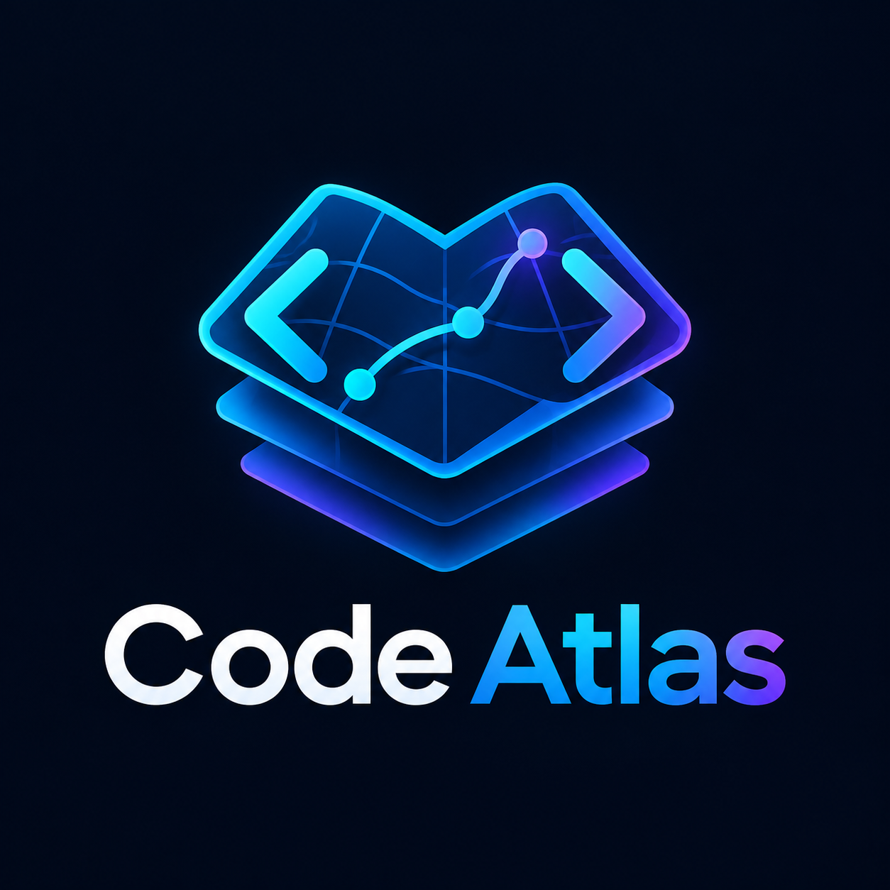

# Code Atlas Forge

<p align="center">
  
</p>

Plataforma **open source, local-first e offline-first** de inteligência estrutural,
semântica e arquitetural de software — grafos tipados, proveniência verificável,
indexação incremental e contexto econômico para agentes.

> **Status atual: Cycle 8 — production quality em andamento
> (branch `cycle-8-production-quality`); Cycle 7 (inteligência de
> domínio + federação) entregue e arquivado.**
> O Code Atlas indexa repositórios com parsing real (Tree-sitter), extrai
> símbolos e constrói um grafo tipado persistido em SQLite, consultável via
> CLI, servidor MCP stdio, **API HTTP loopback `/api/v1`** e o
> **Explorer** — workbench visual Angular servido por
> `code-atlas explorer`. Análise de impacto entre revisões
> (`code-atlas impact` / `POST /impact/analyze`) está disponível com
> estados de binding honestos. O Cycle 7 adiciona **seis adapters de
> domínio opt-in** (SQL, PySpark, AWS data, API contracts, Terraform,
> CI/CD) com grafo de domínio snapshot-scoped (schema v9), **resolução
> cross-domain** por identidade qualificada, **federação multi-repo**
> read-only com pins por snapshot (schema v10), faceta de domínio e
> busca federada no SearchEngine, blast radius misto no Impact Engine,
> context packs de domínio, cinco telas novas no Explorer e layout FA2
> assíncrono em Web Worker (RAF gap máx. 83 ms, era ~2300 ms). Veja
> `docs/cycle-7-architecture.md`, `docs/cycle-7-homologation.md`,
> `docs/cycle-7-limitations.md` e `docs/roadmap.md`.

## Princípios

- **Local-first:** nenhum serviço externo, Docker, conta SaaS ou API key é
  necessário para operar. Nenhum dado sai da máquina por padrão.
- **Sem telemetria:** não existe código de telemetria no projeto — a coleta
  não é apenas desligada por padrão, ela está ausente.
- **O repositório indexado é não confiável:** nada do código varrido é
  executado, importado ou instalado.
- **Evidência primeiro:** toda relação carrega origem, extrator, versão,
  confiança e status de resolução.
- **Determinismo:** a mesma árvore produz o mesmo grafo e os mesmos ids.

A especificação arquitetural normativa está em `docs/BLUEPRINT-v1.md`.

## Instalação

Requer Python 3.12+. Dependências de runtime pinned: `tree-sitter` +
gramáticas (ADR-015) — instaladas automaticamente via wheels.

```bash
git clone https://github.com/EdgarSocrates98/code-atlas-forge.git
cd code-atlas-forge
python3 -m venv .venv
source .venv/bin/activate        # Windows: .venv\Scripts\activate
pip install .
code-atlas --version
code-atlas doctor
```

Para desenvolvimento: `pip install -e .[dev]`.
Detalhes em `docs/install.md`.

## Uso rápido

```bash
code-atlas init --root /caminho/do/repo   # configura o workspace (XDG/APPDATA)
code-atlas doctor                        # verifica ambiente e config
code-atlas index /caminho/do/repo        # incremental é o default; --full força rebuild
code-atlas index . --scip idx.scip       # binding SCIP ad-hoc (proveniência mantida)
code-atlas index . --resolver scip       # restringe resolvers ativos (erro tipado se desconhecido)
code-atlas index-plan /caminho/do/repo   # dry-run do IndexPlan, sem tocar no DB
code-atlas status --json                 # estado do índice, git, migrações
code-atlas semantic-status . --json      # resolvers: installed/enabled/used + coverage do READY

# consultas sobre o snapshot READY (envelope v2)
code-atlas search "Engine" --json        # substring em qualified_name
code-atlas symbol pkg.core.Engine        # detalhe + ocorrências
code-atlas references pkg.util.helper    # incoming, com status/confiança
code-atlas definitions pkg.util.helper   # defs + declarações do símbolo
code-atlas dependencies pkg.app.main --depth 2   # BFS outgoing, cycle-safe
code-atlas graph --json                  # dump de nós+arestas do snapshot

# retrieval híbrido + contexto (Cycle 4)
code-atlas search "q" --strategy lexical|structural|graph|hybrid --limit 10 --json
code-atlas context "create_order" --level focus --budget 4000 --format markdown
code-atlas context-expand --symbol pkg.orders.validate_total --snapshot 1 --delivered sym:pkg.orders
code-atlas mcp                            # servidor MCP stdio (JSON-RPC ndjson)
code-atlas mcp doctor --json              # executável, DB, schema, sqlite_vec
code-atlas mcp manifest --host claude-code   # emite config (nunca escreve)

# impacto entre revisões/snapshots (Cycle 5)
code-atlas impact report --base HEAD~1 --target HEAD --format json

# API local + Explorer visual (Cycle 6)
code-atlas api --port 8741                # só /api/v1, loopback, read-only
code-atlas explorer --open                # API + UI Angular compilada

# domínios + federação (Cycle 7 — opt-in, default OFF)
code-atlas index . --domains sql,pyspark --cross-domain   # extrai domínio no snapshot
code-atlas domains list                    # adapters registrados (listar não extrai)
code-atlas domains entities --domain sql   # entidades do snapshot READY
code-atlas domains entity 'sql:mart.daily_revenue'
code-atlas domains lineage staging.orders --direction up --depth 3
code-atlas federation create minha-view    # workspace multi-repo
code-atlas federation add minha-view /repo/a
code-atlas federation add minha-view /repo/b
code-atlas federation pin minha-view a 42  # pin de snapshot (latest desfaz)
code-atlas federation view minha-view --json
```

Filtros: `--language`, `--kind`, `--path`, `--snapshot`,
`--relation-type`, `--limit`/`--offset`. Saída JSON estável com
`schema_version`. Detalhes: `docs/structural-search.md`, `docs/hybrid-search.md`,
`docs/graph-retrieval.md`, `docs/context-engineering.md`,
`docs/mcp-server.md`.

Configuração: `--root` > variáveis `CODE_ATLAS_*` > `XDG_CONFIG_HOME` /
`%APPDATA%`. Nada é escrito dentro do repositório indexado.

## Linguagens suportadas (Cycle 2)

Python (`.py`/`.pyi`), TypeScript (`.ts` variantes), TSX (`.tsx`) —
matriz completa com versões de gramática pinned em
`docs/parser-adapters.md`. Arquivos de outras linguagens entram no
inventário como nós `file`, sem extração.

## Limitações

Implementado hoje: parsing sintático real, símbolos/referências/
relações com proveniência por aresta, resolução syntactic **integrada**
a resolvers opt-in SCIP/LSP, indexação incremental com cache
versionado, snapshots atômicos, busca estrutural SQL, **FTS5
snapshot-scoped**, **retrieval híbrido (RRF k=60 + rerank task-aware
opt-in)**, graph retrieval multi-seed com direção por intent,
**context packs** com budget do payload serializado e expansão
progressiva, **servidor MCP stdio** (read-only, homologado com o SDK
oficial `mcp`), **impact engine** entre revisões/snapshots com binding
honesto (`partial`/`mismatch`/`unavailable` nunca viram resultado
verificado), **API HTTP loopback `/api/v1`** stdlib read-only
(ADR-0009), o **Explorer Angular** (`code-atlas explorer`) — grafo
bounded, busca, impacto, revisões, context packs e diagnósticos — e,
no Cycle 7, **adapters de domínio opt-in** (SQL/PySpark/AWS data/
API/Terraform/CI-CD, stdlib-only, zero deps novas), **grafo de
domínio** persistido com estados `resolved`/`ambiguous`/`unresolved`/
`external`, **resolução cross-domain** por identidade qualificada,
**federação multi-repo** com snapshot pinado por membro, **busca
federada** e faceta `domain`, **blast misto** símbolo+domínio,
**context packs de domínio** e **views de domínio no Explorer**
(`/lineage`, `/contracts`, `/infra`, `/pipelines`, `/federation`).

**Não implementado** (por design): type-checking real (resolver
sintático não infere receiver — `d.speak()` fica `unresolved`),
embeddings semânticos reais (provider naïve documentado, ADR-0022),
structural sharing de grafo entre snapshots (rejeitado, ADR-0020),
escrita via API/UI (read-only por contrato), telemetria (ausente por
spec), conexão com cloud real (adapters de domínio leem só artefatos
declarados no repo — zero rede, zero execução), mutação de federação
por HTTP (CLI-only), FTS de entidades de domínio (`q=` é `LIKE`).

**Homologado com ressalvas** (Cycle 6.1 — `docs/cycle-6.1-limitations.md`):
sem benchmark de 10k nós (máximo medido: 2000 renderizados; API trunca a
2000, canvas capa a 500/2000), arestas do overview sem custo medido
(0 edges por design), Firefox/Safari/Windows interativo **NOT RUN**,
sem passeio com screen reader, ~55 vulnerabilidades `npm audit` (0
critical em produção — `docs/cycle-6.1-dependency-audit.md`).
**Verificado no 6.1:** 102 testes Playwright (flows, security, a11y,
scale, screenshots) verdes no job `explorer-e2e`; auditoria axe WCAG 2.2
AA em 24 scans com **0 violações**; rate limit 300/min + timeout 30 s +
CSP/XFO na API; drill-down via `GET /files/{id}/occurrences`;
`evidence_ids` emitidos nas arestas; canvas congelado pós-relayout
corrigido e medido; `npm ci` reproduzível.
Estados `unresolved`/`ambiguous`/`external` são preservados como
fatos — nunca preenchidos por heurística. Detalhes:
`docs/semantic-resolution.md`, `docs/cycle-3.1-evidence.md`,
`docs/semantic-accuracy-report.md`, `docs/cycle-6-homologation.md`,
`docs/cycle-6.1-evidence.md`, `docs/cycle-7-homologation.md`,
`docs/cycle-7-limitations.md`.

## Estrutura do repositório

```
src/code_atlas/     pacote (layout src; deps pinned = tree-sitter)
  contracts/        modelos de domínio, enums, ports (hexagonal)
  discovery/        scanner Git-aware + manifest de inventário
  parsers/          engine + registry + adaptadores tree-sitter
  graph/            builder canônico, identidades, validação
  resolvers/        syntactic + SCIP/LSP opt-in, enrichment, bootstrap
  storage/          SQLite: migrações v1-v10, snapshots, FTS5
  indexing/         coordinator + persistência do grafo
  search/           StructuralSearch (SQL parametrizado)
  impact/           ImpactEngine: diff, binding, blast misto, risco, testes
  domains/          adapters de domínio opt-in (sql, pyspark, aws, api,
                    terraform, cicd) + registry, identity, crossresolve
  federation/       workspaces multi-repo, pins, views (schema v10)
  eval/             suporte do runner de avaliação por goldens
  api/              HTTP loopback read-only /api/v1 (stdlib, ADR-0009)
  observability/    logging estruturado + redaction (sem telemetria)
explorer/           workbench Angular 18 (SPA servida por `code-atlas explorer`)
tests/              suíte pytest (unitários, golden corpus, e2e, bench)
docs/               blueprint, ADRs, roadmap, schemas, evidências
factory/            specs Loop Factory (inbox/active/archive + audit)
benchmarks/         bench_scan (cycle-1) + bench_index (cycle-2)
```

## Desenvolvimento

```bash
pip install -e .[dev]
ruff check src tests && mypy src && pytest -q
```

## Licença

Apache-2.0 — veja `LICENSE` e `NOTICE`.
