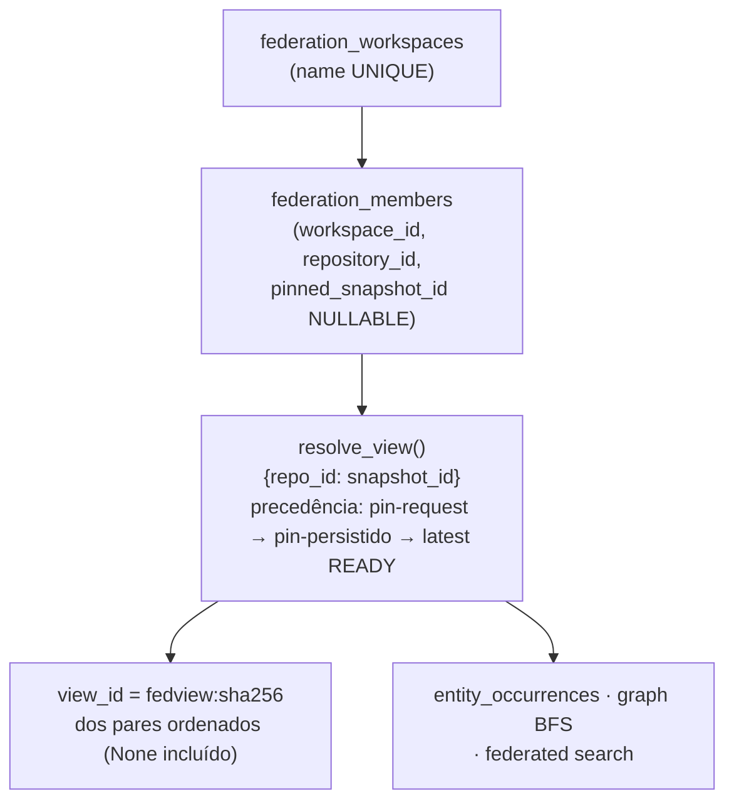

# Cycle 7 — Arquitetura: inteligência de domínio e federação

> Status: branch `cycle-7-domain-intelligence-federation`, specs
> lf-0109–lf-0126. Tudo verificado contra os arquivos citados. O
> contrato base dos ciclos anteriores **não muda**: local-first, zero
> telemetria, repositório indexado não confiável, evidência primeiro,
> determinismo, isolamento de snapshot entre repositórios. O Cycle 7
> adiciona um segundo grafo — o de **domínio** — persistido ao lado do
> grafo de código, alimentado por adapters opt-in, e uma camada de
> **federação read-only** sobre repositórios já indexados.

## 1. Visão geral do pipeline

```mermaid
flowchart LR
    subgraph index["Indexação (IndexCoordinator — mesma transação BEGIN IMMEDIATE)"]
        scan["discovery\ndependency-aware"] --> parse["parsers\n(tree-sitter)"]
        parse --> graph["graph builder\nsnapshot-scoped"]
        subgraph dom["fase de domínio — opt-in"]
            reg["DomainRegistry\n(adapters registrados)"] --> ext["extract()\npor artefato"]
            ext --> val["validate_extraction\ncontrato + evidência"]
        end
        graph --> persist["persist_graph"]
        val --> pd["persist_domain_result"]
        pd --> cross["CrossDomainResolver\n(opt-in)"]
        persist --> tx["COMMIT snapshot"]
        cross --> tx
    end
    tx --> reads["leituras read-only:\nCLI · API /api/v1 · MCP · Explorer"]
    reads -.-> fed["Federation\nviews sobre snapshots READY/STALE"]
```

Ordem garantida: `_extract_domains` roda **fora** do write lock
(espelha o parse); `_persist_domains` e o `cross_resolver` rodam
**dentro** do mesmo `BEGIN IMMEDIATE` de `persist_graph` — falha em
qualquer fase faz rollback do snapshot inteiro
(`src/code_atlas/indexing/coordinator.py`).

## 2. Modelo de domínio (schema v9, lf-0110)

Três tabelas novas em `storage/migrations.py` (v9), todas
snapshot-scoped:

| Tabela | Conteúdo |
|---|---|
| `domain_entities` | Entidade lógica: `domain`, `kind`, `identity_key`, `qualified_name`, `name`, `catalog`, `namespace`, `environment`, `attributes` (JSON) — repo-scoped, estável entre snapshots |
| `domain_entity_occurrences` | Observação de uma entidade num snapshot: `entity_id`, `snapshot_id`, `source_file_id`, `line`, `extraction_status` (`extracted`/`partial`/`failed`) |
| `domain_relations` | Arestas: `snapshot_id`, endpoints `from/to_entity_occ_id` + `from/to_symbol_occ_id`, `to_unresolved`, `type`, `resolution_status`, `confidence_class`, `resolver`, `evidence_ids` |

Vocabulário fechado (`src/code_atlas/domains/model.py`):

- **`DomainEntityKind`** (20 kinds): `data_table`, `data_column`,
  `data_view`, `data_transformation`, `data_pipeline`, `spark_job`,
  `glue_job`, `data_catalog`, `iceberg_table`, `api_endpoint`,
  `api_service`, `api_contract`, `terraform_resource`,
  `terraform_module`, `iam_role`, `cicd_workflow`, `cicd_job`,
  `repository` (federação), `project`.
- **`DomainRelationKind`**: `READS_FROM`, `WRITES_TO`, `TRANSFORMS`,
  `DERIVES_FROM`, `DEPENDS_ON`, `CALLS_ENDPOINT`,
  `IMPLEMENTS_CONTRACT`, `PROVISIONS`, `USES_RESOURCE`, `ASSUMES_ROLE`,
  `TRIGGERS`, `DEPLOYS`, `TESTS`, `REFERENCES`, `CONTAINS`.

### 2.1 Identidade (`domains/identity.py`)

`DomainIdentity` é a chave de colisão entre domínios — segmentos
posicionais percent-encodados:

```
dom:<domain>/<repository>/<root>/<catalog>/<namespace>/<environment>/<qname>[/<snapshot>]
```

- `logical_key()` — sem snapshot: identidade por repositório
  (persistida em `domain_entities.identity_key`);
- `canonical_key()` — com snapshot quando presente;
- `display()` — forma humana `domain:catalog.namespace.qname@env`,
  nunca usada como chave.

A regra de ouro: **mesmo nome com qualificador diferente nunca
colide**. `other.orders` ≠ `mart.orders`; `shared_db.dim_customer` na
conta `111111111111` ≠ o da conta `222222222222` (medido na eval AWS —
três entidades distintas, `docs/cycle-7-evaluation.md`).

### 2.2 Contrato do adapter (`domains/contracts.py` + `registry.py`)

- `DomainAdapter` declara `domain_id`, `adapter_version`,
  `supported_artifacts()` (extensões/globs) e `extract(request) →
  DomainExtractionResult` (entities + relations + evidence +
  diagnostics).
- `DomainRegistry.register()` é o **único** caminho de ativação —
  `IndexCoordinator(domain_registry=None)` produz zero trabalho de
  domínio e preserva o índice pré-Cycle-7 byte a byte.
- `discover_entrypoints()` (`code_atlas.domain_adapters` entry-point
  group) existe mas é **opt-in por chamada** — código de terceiros
  nunca é importado implicitamente (ADR-0014).
- Habilitar/desabilitar/atualizar adapter entra em
  `analyzer_versions` como `domain:{id}` → derrota o no-op de digest
  por construção.
- Ausência honesta: `get()` → `None`, `enabled()` omite, `require()`
  → `UnknownDomainError`; domínio desabilitado emite zero fatos.

## 3. Os seis adapters entregues

Todos **stdlib + `code_atlas` apenas** — HCL, YAML-subset, tokenização
SQL, parsing OpenAPI e AST PySpark implementados em-repo (sem
`pyyaml`/`hcl2`/`sqlglot`/`boto`). Custo medido por fixture
(`benchmarks/results/domains-latest.json`, mediana):

| Adapter (`domain_id`) | Pacote | Fixture | Artefatos | Mediana | Ent./Rel. |
|---|---|---|---|---|---|
| `sql` | `domains/sql/` (tokens/nodes/parser/extract) | `sql_warehouse` | 4 | 4.5 ms | 36 / 32 |
| `pyspark` | `domains/spark/` (walk/extract/sqllit) | `pyspark_repo` | 7 | 8.3 ms | 37 / 62 |
| `aws-data` | `domains/aws/` (configs/pyfiles/sqlbridge) | `aws_repo` | 13 | 8.6 ms | 63 / 60 |
| `api` | `domains/api/` (openapi/routes/consumers/yaml_subset) | `api_repo` | 12 | 5.0 ms | 30 / 43 |
| `terraform` | `domains/terraform/` (hcl/extract/refs/tfvars/tfjson/catalog) | `terraform_infra` | 13 | 3.8 ms | 24 / 45 |
| `cicd` | `domains/cicd/` (yamlmini/workflow/classify) | `cicd_repo` | 4 | 2.8 ms | 13 / 34 |

Invariantes comuns a todos: extração **estática** (nada é executado —
sem jobs, SQL, Spark, Terraform, pipelines, conexões); recuperação por
artefato/statement (entrada malformada vira diagnóstico, nunca exceção
que derruba o restante); estados honestos `resolved`/`ambiguous`/
`unresolved`/`external`; marcadores dinâmicos (`dynamic:*`,
`${{ secrets.* }}` → `<secret>`, `${…}` → `${dynamic}`) nunca
materializam valores; toda aresta carrega `DomainEvidence`
(`extractor="domain:<id>"`, `adapter_version`).

Delta de indexação medido (`crossdomain_ws`, mediana de 7):
registry off **44.3 ms** → all-adapters **55.1 ms** = **+10.8 ms**
total (`docs/cycle-7-adapters.md`).

## 4. Resolução cross-domain (lf-0117, Phase 9)

`CrossDomainResolver.plan(store, snapshot_id)` é opt-in
(`IndexCoordinator(cross_resolver=…)`), stateless, read-only sobre
estado persistido — roda depois de todos os adapters, dentro da mesma
transação de publicação. Regra central: **nunca casa por nome nu** —
exige concordância de identidade qualificada
(`catalog`/`namespace`/`environment`/`root` + `qualified_name`;
account+region+resource para ARNs; `method+path` literal para
endpoints; path repo-relativo literal para artefatos/scripts).

Dois mecanismos: **updates** re-resolvem linhas `unresolved` in-place
com evidência dos dois lados; **edges** criam pares entity↔entity
(`REFERENCES`/`PROVISIONS`) sempre com `evidence_ids` de ambos os
lados ou nada. `ambiguous` persiste os candidatos em `to_unresolved`
— nunca promovido. Auditoria `_validate`: aresta de domínio cujo
endpoint escapa do snapshot **aborta a publicação**
(`docs/cycle-7-cross-domain-resolution.md`).

Medido no cenário `crossdomain`: `cross_resolved=3`,
`cross_ambiguous=3`, `cross_edges=4` — incluindo `shared.metrics`
ambíguo (dois catálogos candidatos) mantido ambíguo honestamente.

## 5. Federação multi-repo (lf-0118, Phase 10 — schema v10)



- **Isolamento por membro**: toda consulta de ocorrência carrega
  `deo.snapshot_id = <snapshot resolvido DAQUELE membro>` — pinar A no
  snapshot antigo esconde as entidades novas de A sem tocar B.
- **Join cross-repo é `shared_key`**, nunca nome nu: `identity_key`
  menos o segmento `repository`
  (`dom:<domain>/<root>/<catalog>/<ns>/<env>/<qname>`). `other.orders`
  nunca linka a `mart.orders`.
- **Arestas federadas são computadas, nunca persistidas**:
  `shared_entity` (`computed=true`, `resolver=federation-view`,
  `relation_id=null`) une entidades com mesmo `shared_key` em membros
  diferentes; `intra` são exatamente as linhas persistidas de cada
  snapshot. Nada é inserido em `domain_relations`.
- **HTTP é read-only por desenho**: create/add/pin existem só na CLI;
  handlers rodam na conexão `query_only`. Mutação por HTTP não tem
  rota (404).
- BFS federado limitado: `MAX_GRAPH_DEPTH=8`, `limit≤5000`,
  `truncated` declara o corte.

Detalhes: `docs/cycle-7-federation.md`.

## 6. Integrações com engines existentes

O prompt veda uma segunda implementação de busca/impacto/contexto por
domínio — o Cycle 7 **estende** as engines existentes:

### 6.1 Busca (lf-0119, Phase 11)

- `SearchRequest.domain` filtra a faceta de entidades de domínio
  (`de.domain = ?`); `SearchResult.domain_items` +
  `domain_total` formam uma faceta separada, **nunca fundida** com hits
  de símbolo (`search/contracts.py`).
- `DomainSearchHit` carrega `domain`, `kind`, `qualified_name`,
  `entity_id`, `item_type="domain_entity"` — o hit de domínio explica
  seu próprio match (aresta `domain_relations` adjacente = evidência).
- `FederatedSearchEngine` (`search/federated.py`) pesquisa cada membro
  no **próprio** `(repo, snapshot)` resolvido pela view; merge
  posicional determinístico; items tagueados
  `repository_id`+`snapshot_id`; homônimos cross-repo nunca colapsam.
- Mesma superfície `/search` com `workspace=`/`federation=`,
  `pin=repo:snap`, `repository_id=` narrowing — envelope da família
  search + identidade da view.

### 6.2 Impacto cross-domain (lf-0120, Phase 12)

`ImpactEngine._blast` agora executa BFS **misto** sobre `relations`
(código) + `domain_relations` (entidade/símbolo) dentro de **um
snapshot**. Direção por semântica de aresta: dependant-side
(`READS_FROM`, `DERIVES_FROM`, `CALLS_ENDPOINT`, …) percorre
`to → from`; acopladas (`WRITES_TO`, `TRANSFORMS`, `PROVISIONS`,
`TRIGGERS`, `DEPLOYS`, `DEFINES`) percorrem ambos; `REFERENCES`
identidade simétrica (par cross-domain) também ambos.

Honestidade de incerteza: hop `ambiguous`/`unresolved`/`external`
**rebaixa** o candidato para `possible` — nunca promove;
`to_unresolved` vira `uncertain_deps` do nó + contadores
`domain-<status>-deps:N` em `unknown_coverage`; endpoints em outro
snapshot viram `domain-cross-snapshot:N` (guarda de federação em
tempo de leitura). `ImpactPath.edge_refs` tipa a proveniência
(`rel:<id>` vs `dom:<id>`). Seeds de entidade entram por
`ImpactRequest.entity`/`symbol` (4 formas aceitas:
`dom:<identity_key>`, row id, `display()`, qualified name) —
`docs/cycle-7-cross-domain-impact.md`.

### 6.3 Context packs de domínio (lf-0121, Phase 13)

`DomainContextEngine(ContextEngine).build_domain(DomainPackRequest)`
produz um `ContextPack` envelope v2 normal com a seção aditiva
`domain` (`schema_version=1`) — consumidores v2 ignoram a chave extra.
Seeds por `dom:<key>` / `entity:<id>` / `qualified_name` (>1 match →
`seed-ambiguous`, nunca escolha aleatória). `counts` agrega **todas**
as arestas que tocam a semente (incluindo markers `dynamic` contados
separadamente); vizinhos top-N por confiança com dedup por ref;
`expansion_refs[].ref_id` é ref resolvível com contrato documentado
no próprio pack (`domain.requery`); a seção é reconstruída dentro do
loop de budget — custo contado, vizinho cortado vira `expansion_ref`.
`docs/cycle-7-domain-context-packs.md`.

## 7. Superfícies de leitura

### 7.1 API (`/api/v1`, GET read-only — handlers.py)

Novas rotas de domínio: `/domains`, `/domains/entities`,
`/domains/entities/{id}/neighbors`, `/domains/relations`,
`/domains/lineage`. Novas rotas de federação:
`/federation/workspaces*`, `/{id}/view`, `/{id}/entities/{key}/
occurrences`, `/{id}/graph`, `/{id}/search`. `?pin=` aceito nas rotas
de view/occurrences/graph/search. Inventário completo com parâmetros
em `docs/cycle-7-evidence.md`.

### 7.2 CLI (lf-0123)

- `code-atlas index --domains sql,pyspark,…|'all'` + `--cross-domain` —
  opt-in explícito, default OFF.
- `code-atlas domains list|entities|entity <key>|lineage <key>` —
  consulta read-only snapshot-scoped.
- `code-atlas federation create|add|pin|view` — **única superfície de
  mutação** da federação.

### 7.3 MCP (lf-0123 — `src/code_atlas/mcp.py`)

15 tools no total; novas: `atlas_domains` (adapters registrados),
`atlas_domain_entity` (cartão de entidade), `atlas_domain_lineage`
(BFS READS/WRITES bounded), `atlas_federation_view` (view
repo→snapshot). `atlas_domains` + `atlas_federation_view` são
`_GLOBAL_TOOLS` — resolvem sem âncora repo/snapshot.

### 7.4 Explorer (lf-0122 — Angular, 5 rotas novas)

| Rota | Componente | Consome |
|---|---|---|
| `/lineage` | `LineageComponent` | `GET /domains/lineage` |
| `/contracts` | `ContractsComponent` | `/domains/entities` (kind api_*) |
| `/infra` | `InfraComponent` | `/domains/entities` + relations (terraform/aws) |
| `/pipelines` | `PipelinesComponent` | `/domains/entities` (cicd/spark) |
| `/federation` | `FederationComponent` | `/federation/workspaces*` |

Utilitário compartilhado `features/domains/domain.utils.ts` (+spec).

### 7.5 Grafo — hardening de plataforma (lf-0109, Phase 0)

- **FA2 assíncrono em Web Worker** (`features/graph/fa2.worker.ts` +
  `fa2-layout-runner.ts`): worker module same-origin (CSP-safe, sem
  blob:), token geração+versão descarta resultado obsoleto, cancel =
  no-op honesto preservando pins/seleção. **Medido: RAF gap máximo
  83 ms durante relayout** (era ~2300 ms de bloqueio de main thread).
- **Benchmarks de grafo denso** (`e2e/graph-dense.spec.ts`,
  `docs/graph-dense-benchmarks.md`): encontraram e o commit `a250a39`
  corrigiu dois bugs reais — crash `updateEachEdgeAttributes` sem
  hints (refresh skipIndexation em arestas não indexadas) e
  `ApiFileOccurrence.id` tipado errado (`"occ:N"` string vs number →
  drill 400).

## 8. Segurança e empacotamento (lf-0125, Phases 17–19)

Bateria `tests/security/test_domain_security.py` assegura: valores de
segredo de fixtures Terraform nunca aparecem em entidades/relações/
evidência **nem em linhas persistidas**; zero imports de rede
(`http`/`socket`/`urllib`/`boto*`/`requests`/`asyncio`/`ssl`) sob
`domains/`+`federation/`+`eval/`; zero `subprocess`/`pty`/
`multiprocessing`/`eval`/`exec`/`compile`/`import_module`/`os.system`;
contenção de path (`..`/absoluto recusados, `Path.is_relative_to` —
fix de separador Windows); API segue loopback-only.

**Zero novas dependências de runtime**: os seis adapters ship dentro
do mesmo wheel `code_atlas` — não há `extras` de domínio porque não há
nada extra a instalar (verificado por
`test_domain_packages_import_only_stdlib` + wheel build inalterado).

## 9. Avaliação medida (lf-0124, Phase 16)

`evaluation/run_eval.py` executa a pipeline real sobre fixtures
versionadas e compara o estado **persistido** contra goldens curados
(`evaluation/golden/`): contagem exata de entidades/relações com
quebras por tipo/status/confiança/resolver, inventário exaustivo de
arestas (set-compare), entidades `expected`/`forbidden`
(anti-fabricação), multiconjunto exato de diagnósticos e
`edges_skipped`. Resultado: **todas as arestas persistidas casam** nos
7 cenários — zero `missing`, zero `unexpected`
(`docs/cycle-7-evaluation.md`,
`evaluation/results/domain-eval-latest.json`).

## 10. Referências

- Specs: `factory/specs/inbox/lf-0109…lf-0126`.
- Docs do ciclo: `cycle-7-adapters.md`, `cycle-7-sql-adapter.md`,
  `cycle-7-cross-domain-resolution.md`, `cycle-7-federation.md`,
  `cycle-7-cross-domain-impact.md`, `cycle-7-domain-context-packs.md`,
  `cycle-7-evaluation.md`, `graph-dense-benchmarks.md`.
- ADR-0010 (domain adapters), ADR-0009 (API), ADR-0020 (snapshots
  completos), ADR-0021 (precedência de evidência).
- Código: `src/code_atlas/domains/`, `federation/`, `eval/`,
  `search/federated.py`, `impact/domain_traversal.py`,
  `context/domain.py`, `api/handlers.py`, `cli.py`, `mcp.py`,
  `explorer/src/app/features/domains/`.
