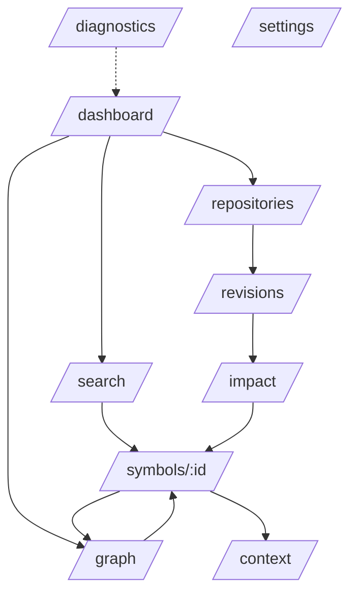
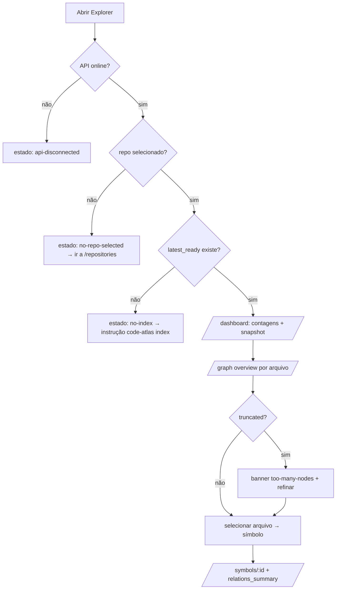
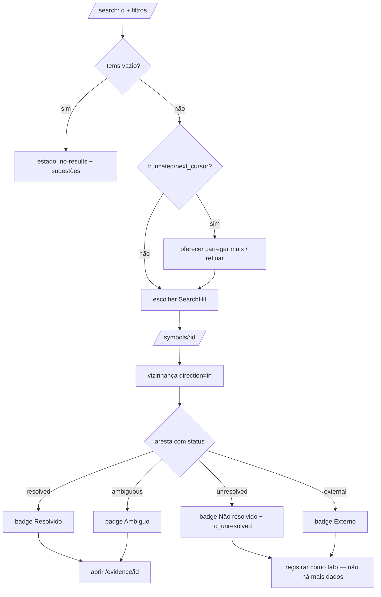
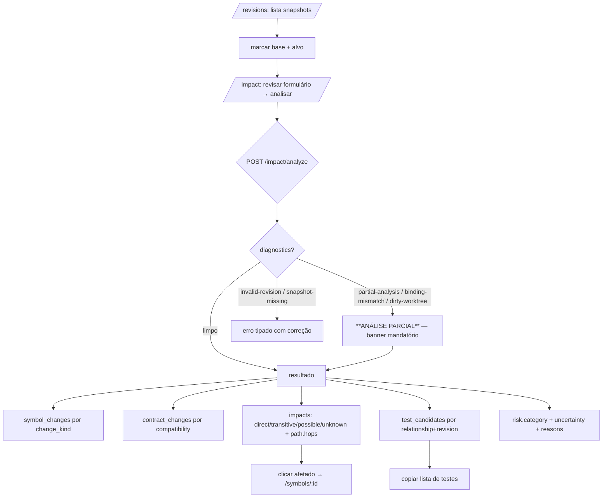
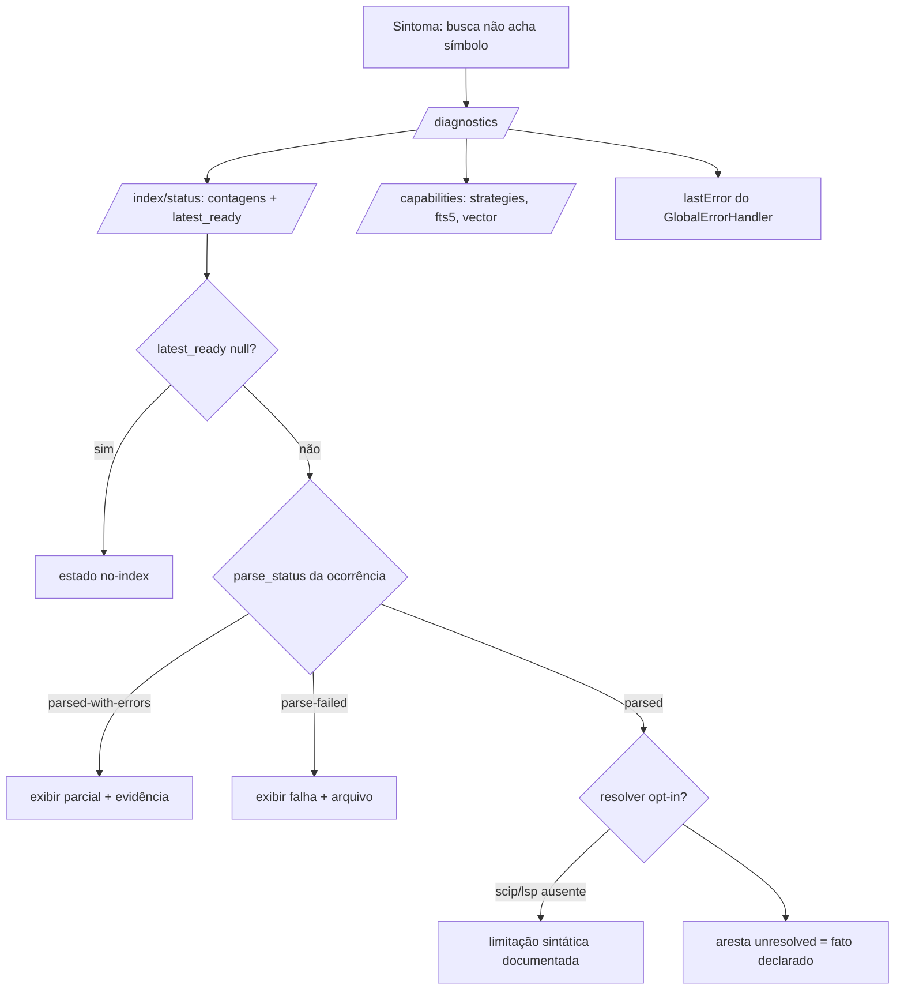
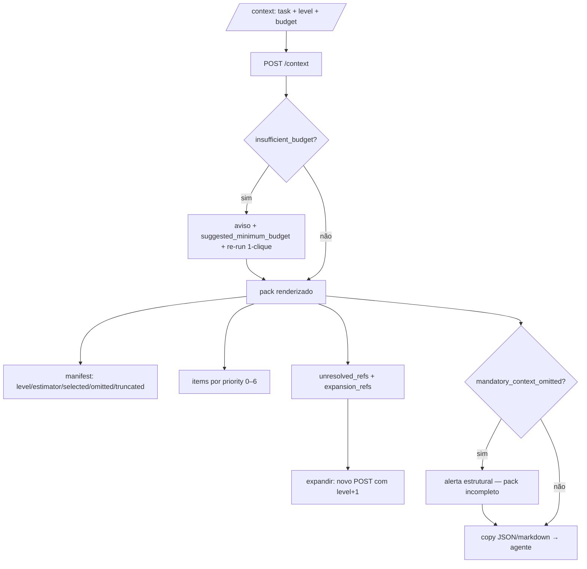

# Code Atlas Explorer — Especificação UI/UX (Cycle 6)

> Spec **lf-0084** · companheira de `explorer-product-spec.md`.
> Mesma convenção: **[real]** existe hoje · **[alvo-C6]** especificado
> para lf-0087…lf-0093 · **[roadmap]** fora do ciclo.
> Toda referência a endpoint/campo foi verificada em
> `src/code_atlas/api/handlers.py` e nos contratos de domínio.

---

## 1. Arquitetura de informação

### 1.1 Mapa rotas → features → dados

| Rota | Feature | Dados da API consumidos | Entradas do usuário | Saídas/navegação |
|---|---|---|---|---|
| `/dashboard` | Painel | `GET /index/status` (contagens por repo), `GET /repositories`, `GET /capabilities` | — | links para graph/search/impact/diagnostics; seletor de repo |
| `/repositories` | Repositórios | `GET /repositories` (`id`, `identity_key`, `root_handle`), `GET /index/status`, `GET /repositories/{id}/snapshots` | selecionar repo ativo | grava `RepositoryContextService.selected`; propaga `repository_id`/`repository_root` a todas as consultas |
| `/graph` | Grafo | `GET /graph/overview` (arquivos: `path`, `symbols`, `language`; `total_files`, `truncated`), `GET /graph/neighbors` (`edges`, `nodes`, `truncated`) | pan/zoom, seleção, expansão, filtros | → `/symbols/:id` |
| `/search` | Busca | `GET /search` (`SearchHit`, `next_cursor`, `truncated`, `diagnostics`, `ranking_version`) | `q`, `strategy`, `language`, `kind`, `path`, paginação por cursor | → `/symbols/:id` |
| `/symbols/:id` | Símbolo | `GET /symbols/{occ}` (nó + `relations_summary`), `GET /graph/neighbors`, `GET /evidence/{id}` | direção in/out/both, expandir | → `/graph` focado, `/context` |
| `/impact` | Impacto | `POST /impact/analyze` → `ImpactResult` completo | `base_revision`, `target_revision`, `symbol`/`file`, `include_possible`, `known_only` | → `/symbols/:id`, `/revisions`, export |
| `/revisions` | Revisões | `GET /repositories/{id}/snapshots` (`id`, `status`, `commit_sha`, `git_ref`, `created_at`) | marcar base/alvo | → `/impact` pré-preenchido |
| `/context` | Context Packs | `POST /context` → `ContextPack` (`manifest`, `budget`, `items`, `expansion_refs`, `diagnostics`) | `task`, `level`, `budget_tokens`, `max_symbols` | copy pack; → `/symbols/:id` |
| `/diagnostics` | Diagnósticos | `GET /index/status`, `GET /capabilities`, `GlobalErrorHandler.lastError` **[real]**, diagnósticos coletados das engines | — | → tela de origem do problema |
| `/settings` | Configurações | `GET /capabilities` (exibir `api_version`, `readonly`) | preferências locais | persiste `localStorage` apenas |

### 1.2 Casca (`shell`) — anatomia

**[real]** já implementada:
```
┌────────────────────────────────────────────────────────┐
│ skip link → "Pular para o conteúdo principal"          │
├────────────────────────────────────────────────────────┤
│ TOOLBAR: Code Atlas Explorer │ [repo.root_handle] │ 🌙 │
├──────────┬─────────────────────────────────────────────┤
│ SIDEBAR  │  MAIN #shell-main (tabindex=-1)             │
│ Painel   │   <router-outlet>                            │
│ Grafo    │                                             │
│ Busca    │                                             │
│ Impacto  │                                             │
│ Context… │                                             │
│ Diagnóst…│                                             │
│ Config…  │                                             │
└──────────┴─────────────────────────────────────────────┘
```

**[alvo-C6]** ajustes de IA:
- Sidebar passa a 9 itens: adicionar **Repositórios** (após Painel) e
  **Revisões** (antes de Impacto) — rotas existem, só faltam no `NAV_ITEMS`.
- Toolbar ganha: (a) **seletor de repositório funcional** (hoje
  somente-leitura, gap declarado); (b) **selo de snapshot** —
  `snapshot_id`/`commit_sha` curto do snapshot consultado, com tooltip
  `status`/`created_at`; (c) **indicador de conexão** discreto
  (online: `GET /health` ok; offline: ícone + texto "API offline").
- Símbolo `:id` na rota `/symbols/:id` é o **`occurrence_id` numérico**
  (a API rejeita não-inteiro com `bad-param`); a UI aceita também a forma
  canônica `occ:N` digitada/copiada, fazendo o strip do prefixo.

### 1.3 Hierarquia de navegação



Regras:
- Toda tela dependente de dados carrega `repository_id` +
  `snapshot_id` (ou `repository_root`) do contexto global; **nunca**
  consulta "o primeiro repo" silenciosamente — quando nada está
  selecionado, exibir estado `no-repo-selected` (variante de `empty`).
- `snapshot_id` default = `latest_ready` do repo (resolução que a API já
  faz quando o param é omitido); a UI mostra qual foi usado.
- Deep-linking: `/symbols/:id`, `/search?q=…`, `/impact?base=…&target=…`
  devem restaurar estado pela URL **[alvo-C6]** — trabalho local é
  compartilhável entre abas sem servidor.

## 2. Modelo mental da interface

Três níveis de zoom que nunca se misturam:

| Nível | Visualização | Endpoint | Limite |
|---|---|---|---|
| **Macro** — arquivos | `/graph/overview`: lista/agregado por arquivo (path, nº símbolos, linguagem) | `/graph/overview` `limit` ≤2000 | `total_files`, `truncated` |
| **Meso** — vizinhança | canvas: nó foco + arestas + nós vizinhos | `/graph/neighbors` `limit` ≤200 | `truncated` |
| **Micro** — símbolo/aresta | inspetor: detalhe, `relations_summary`, evidência | `/symbols/{id}`, `/evidence/{id}` | — |

> A API **não** expõe "o grafo inteiro" — o nível macro é sempre
> agregado por arquivo e o meso é sempre vizinhança de um foco. A UI
> herda esse modelo: **não existe modo "grafo completo"**.

## 3. Fluxos de usuário

### 3.1 Explorar repositório (Jornada A)



### 3.2 Entender dependência (Jornada B)



### 3.3 Analisar mudança (Jornada C)



### 3.4 Debug (Jornada D)



### 3.5 Contexto para agente (Jornada E)



## 4. Especificações de interação

> Interações do canvas/lista são **[alvo-C6]** (lf-0088/89/90); os
> componentes ainda não existem — este é o contrato que eles implementam.
> Toda ação destrutiva/ambígua tem equivalente de teclado e `aria-label`.

### 4.1 Modelo de seleção e foco (global)

| Ação | Ponteiro | Teclado | Resultado |
|---|---|---|---|
| Selecionar item | click | `Enter`/`Espaço` sobre item focado | seleção única visível (anel `--atlas-color-focus-ring` + painel de detalhe) |
| Seleção múltipla | `Ctrl+click` | `Shift+setas` (listas) | conjunto marcado; ações em lote limitadas a copy/isolar |
| Mover foco | — | `Tab`/`Shift+Tab` entre regiões; setas dentro de lista/canvas | ordem de tabulação = ordem visual |
| Fechar painel/menu | `Esc` | `Esc` | retorna foco ao elemento que abriu |
| Atalhos globais | — | `/` foca busca; `g d/g/s/i/c` navegam; `?` abre legenda de atalhos | nunca conflita com input de texto |

Foco no grafo: nó focado tem contorno duplo (cor + largura extra) —
seleção nunca só muda cor. Painéis sobrepostos (inspector, context menu)
são `role="dialog"`/`role="menu"` com foco preso enquanto abertos.

### 4.2 Canvas de grafo (meso — vizinhança)

| Interação | Gesto | Efeito especificado |
|---|---|---|
| **Select** | click no nó | seleciona; abre inspector lateral com `GET /symbols/{occ}` (qname, kind, language, path, span, `parse_status`, `relations_summary`) |
| **Expand** | **double-click** no nó | `GET /graph/neighbors?occurrence_id=&direction=both&limit=50` → mescla vizinhos ao canvas; nó expandido fica marcado (anéis concêntricos) |
| **Expand in** | menu de contexto → "Expandir entrantes" | `direction=in` — revela quem referencia o foco |
| **Expand out** | menu de contexto → "Expandir saintes" | `direction=out` — revela o que o foco referencia |
| **Context menu** | botão direito no nó | menu: `Selecionar` · `Expandir entrantes` · `Expandir saintes` · `Fixar`/`Soltar` · `Isolar vizinhança` · `Abrir página do símbolo` · `Copiar qname` · `Copiar referência de evidência` |
| **Pin** | "Fixar" / tecla `P` sobre nó focado | congela posição do nó no layout; badge 📌 + `aria-pressed`; sobrevive a expansões até soltar |
| **Isolate** | "Isolar vizinhança" / tecla `I` | esconde nós não-conectados ao foco em N hops; banner "N nós ocultos — [Desfazer isolamento]" sempre visível |
| **Copy qname** | `Ctrl+C` sobre seleção / item de menu | copia `qname` textual (ex.: `pkg.util.helper`) |
| **Copy evidence** | item de menu | copia referência canônica `occ:{occurrence_id}` e/ou `evidence_ids` da aresta selecionada |
| Zoom | scroll/pinch | limitado a `[0.1×, 4×]`; indicador de zoom sempre visível; **câmera nunca desaparece** (gate do roadmap C6) — pan/zoom têm limites calculados do bounding box dos nós + margem |
| Pan | arrastar fundo | limitado ao bounding box + 25% |
| Reset | botão "Recentrar" / tecla `0` | recoloca foco central com zoom 1× |
| Legenda | botão "Legenda" / tecla `?` | painel com os 5 estados de evidência (cor+glifo+texto) e tipos de aresta — sempre acessível, também por teclado |

Regras invioláveis do canvas:
- **Orçamento de nós:** canvas renderiza no máximo **N_max = 500** nós
  simultâneos (alinhado a `ImpactLimits.max_nodes=500`); ao exceder,
  entra o estado `too-many-nodes` (§5.9) — nunca degrada silenciosamente.
- **Aresta sempre tipada:** estilo por `type` (CALLS, IMPORTS, EXTENDS…)
  + estado por `resolution_status` (§6); `to_unresolved`/`external`
  renderizam como nó-fantasma tracejado, nunca omitidos.
- **Sem layout "mágico":** posições estáveis por `occurrence_id` entre
  expansões; nó existente nunca teleporta — expansões animam apenas os
  nós novos (respeitando `prefers-reduced-motion`).
- **Vazio honesto:** vizinhança de nó sem arestas mostra "Sem relações
  registradas neste snapshot" — distinto de erro e de loading.

### 4.3 Listas, tabelas e busca

- **Busca** (`/search`): input com debounce 300 ms; filtros `strategy`
  (default `hybrid`; `vector` desabilitado com tooltip quando
  `capabilities.search.vector=false`), `language`, `kind`, `path`;
  resultados paginados por `next_cursor` (botão "Carregar mais", nunca
  scroll infinito — cursor é explícito e `truncated` é declarado).
- **Listas** (revisions, repositories, test_candidates): ordenação por
  coluna clicável com `aria-sort`; densidade respeita `--atlas-space-*`.
- **Inspector**: painel lateral (desktop) ou bottom-sheet (largura
  <768px) com `role="complementary"`; fecha com `Esc`.

### 4.4 Clipboard (copiar — sempre local)

| Ação | Payload | Confirmação |
|---|---|---|
| Copiar `qname` | texto puro `pkg.util.helper` | toast "qname copiado" (região `aria-live="polite"`) |
| Copiar referência de ocorrência | `occ:{occurrence_id}` | idem |
| Copiar evidência | `evidence:{id}` + `referencing_relations` ids | idem |
| Copiar lista de testes | `test_file`/`test_symbol` por linha | idem |
| Copiar pack | JSON (`to_dict()`) ou markdown renderizado | idem |

Nenhum payload sai da máquina além do clipboard do SO. Falha de
clipboard (permissão negada) → estado de erro tipado com fallback
"selecionar texto manualmente".

### 4.5 Restauração e cancelamento

- Toda chamada ao `ApiService` aceita `AbortSignal`; navegar fora aborta
  em-flight (`ApiAbortedError` **nunca** vira erro visível — já tratado
  por `GlobalErrorHandler` **[real]**).
- Re-entrar numa tela restaura o último estado local (query, filtros,
  foco) — persistidos em memória de sessão, **não** em storage remoto.

## 5. Catálogo de estados (MANDATORY)

> Toda tela implementa **todos** os estados aplicáveis — ausência de um
> estado previsto é bug de UX. Formato: gatilho → especificação →
> recuperação. `feature-placeholder` **[real]** já cobre
> `loading`/`apiDisconnected`/`empty`; o alvo C6 amplia para o catálogo.

### 5.0 Matriz estados × telas

| Estado | dash | repos | graph | search | symbol | impact | revisions | context | diagnostics | settings |
|---|---|---|---|---|---|---|---|---|---|---|
| loading | ● | ● | ● | ● | ● | ● | ● | ● | ● | — |
| api-disconnected | ● | ● | ● | ● | ● | ● | ● | ● | ● | ○ |
| empty / no-repo-selected | ● | ● | ● | ○ | ○ | ○ | ● | ○ | ○ | — |
| no-index | ● | ● | ● | ● | ● | ● | ● | ● | ● | — |
| error (tipado) | ● | ● | ● | ● | ● | ● | ● | ● | ● | ○ |
| no-results | — | — | — | ● | — | ● | — | ● | — | — |
| snapshot-unavailable | ● | ● | ● | ● | ● | ● | ● | ● | ● | — |
| evidence-missing | — | — | ● | — | ● | ● | — | — | — | — |
| too-many-nodes | ○ | — | ● | ● | ○ | ● | — | ○ | — | — |
| **partial-analysis** | ○ | — | ○ | ○ | — | **●** | ● | ● | ○ | — |

(● = obrigatório · ○ = se aplicável · — = n/a)

### 5.1 `loading`
- **Gatilho:** request em flight >150 ms (abaixo disso não piscar).
- **Spec:** skeleton da estrutura final (não spinner centrado) + texto
  "Carregando…" **[real]** em `aria-live="polite"`; região preserva
  dimensões para não dar salto de layout; foco nunca se move sozinho.
- **Recuperação:** automática; timeout de UX = 30 s → degrada para
  `api-disconnected` com ação "Tentar novamente".

### 5.2 `api-disconnected`
- **Gatilho:** `ApiUnreachableError` (fetch falhou: processo fora do ar).
- **Spec:** `[real]` "API local indisponível em http://127.0.0.1.
  Verifique se o processo do Code Atlas está em execução." — ampliar
  **[alvo-C6]** com comando `code-atlas explorer` copiável e porta
  configurada (`8741` default).
- **Recuperação:** botão "Tentar novamente" refaz a chamada; indicador
  de conexão no toolbar reflete o estado globalmente.

### 5.3 `empty` / `no-repo-selected`
- **Gatilho:** `GET /repositories` → `items: []`, ou nenhum repo
  selecionado em `RepositoryContextService`.
- **Spec:** mensagem + próximo passo explícito: "Nenhum repositório
  indexado — rode `code-atlas index <repo>`" / "Selecione um repositório
  em Repositórios". Nunca só um buraco branco.
- **Recuperação:** link direto para `/repositories` (e instrução CLI
  quando `items: []`).

### 5.4 `no-index` (sem snapshot READY)
- **Gatilho:** `GET /index/status` → `latest_ready: null` para o repo,
  ou API responde `no-repository` 404 / `snapshot-not-ready` 409.
- **Spec:** "Nenhum snapshot pronto — o índice precisa rodar antes de
  consultar." Lista snapshots existentes com `status` (`BUILDING`,
  `FAILED`, `STALE`) e `created_at` para distinguir "ainda indexando"
  de "falhou".
- **Recuperação:** instrução `code-atlas index <root>`; link para
  `/diagnostics` e `/revisions`.

### 5.5 `error` (tipado por código)
- **Gatilho:** `ApiHttpError` com `body.error.code` conhecido.
- **Spec:** tabela de mapeamento — cada `code` tem título + explicação
  + ação. Exemplos reais do backend:
  - `bad-param` → "Parâmetro inválido" + qual parâmetro;
  - `repo-not-found`/`repo-not-indexed` 404 → "Repositório não indexado";
  - `symbol-not-found` 404 → "Símbolo não existe neste snapshot" (sugere
    outro snapshot);
  - `evidence-not-found` 404 → ver §5.8;
  - `payload-too-large` 413 → "Requisição excede 64 KiB";
  - `internal` → "Erro interno" + mensagem ≤200 chars (API nunca vaza
    traceback — a UI não deve inventar detalhe);
  - `not-found` → rota/asset inexistente.
- **Recuperação:** sempre oferecer ação: retry, ajustar parâmetro,
  trocar snapshot, ou ir a `/diagnostics`.

### 5.6 `no-results`
- **Gatilho:** `SearchResult.items: []` com sucesso; `impacts: []`;
  `test_candidates: []`; `items: []` no pack.
- **Spec:** "Nenhum resultado para `q` neste snapshot" + sugestões
  reais: remover filtros, trocar `strategy`, ampliar `path`. **Regra:**
  lista vazia de `test_candidates` renderiza literalmente "Nenhum teste
  candidato — ausência não é evidência de segurança" (frase do domínio:
  `revision-aware-test-selection.md`).

### 5.7 `snapshot-unavailable`
- **Gatilho:** `snapshot-not-ready` 409 (snapshot existe mas não é
  READY), `snapshot-not-found` 404, `snapshot-unavailable`/
  `snapshot-missing`/`snapshot-failed`/`snapshot-for-revision-missing`
  nos diagnósticos de impacto.
- **Spec:** "Snapshot indisponível: {id} está {status}" + lista de
  snapshots READY alternativos do mesmo repo (de
  `/repositories/{id}/snapshots`) + `created_at`.
- **Recuperação:** selecionar outro snapshot (1 clique) ou rodar
  `code-atlas index`; **nunca** degradar para outro snapshot
  silenciosamente — troca exige clique do usuário.

### 5.8 `evidence-missing`
- **Gatilho:** `GET /evidence/{id}` → `evidence-not-found` 404, ou aresta
  cujo `evidence_ids` está vazio, ou `symbol-not-found` após mudança de
  snapshot.
- **Spec:** "Evidência não encontrada neste snapshot — pode ter sido
  gerada em outro." Exibir o que se sabe (`resolver`, `confidence_class`
  da aresta) sem prometer mais.
- **Recuperação:** link para o snapshot que contém a evidência (quando
  identificável) ou volta ao símbolo; nunca fabricar conteúdo.

### 5.9 `too-many-nodes` (bounded rendering)
- **Gatilho:** `/graph/overview` com `truncated=true`; `/graph/neighbors`
  com `truncated=true`; canvas prestes a exceder **N_max=500** nós;
  `SearchResult.truncated`/`ImpactResult.truncated`.
- **Spec:** banner persistente "Mostrando X de Y — refine para ver mais"
  com o número real (`items.length` de `total_files`; `limit` atingido
  em neighbors) + sugestões: filtrar por `path`/`language`/`type`,
  expandir a partir de um foco, aumentar `limit` até o cap (2000/200).
- **Recuperação:** ação de refinar (filtro) ou "Carregar próximos"
  quando há cursor — nunca renderizar além do orçamento.

### 5.10 `partial-analysis` — **MANDATORY, inviolável**
- **Gatilho:** `ImpactResult.diagnostics` contém `partial-analysis`,
  `revision-binding-mismatch`, `content-mismatch`, `dirty-worktree`;
  binding interno `partial`/`mismatch`; `ContextPack.diagnostics.
  mandatory_context_omitted=true`; `truncated=true` em impacto.
- **Spec (estrutural, não cosmética):**
  1. Banner próprio **acima** de qualquer resultado: "⚠ Análise parcial —
     este resultado não cobre todo o diff" + os `code`s reais listados
     (`partial-analysis`, `revision-binding-mismatch`…) com `message`.
  2. O banner usa a rampa `warning` + marcador `◆` + texto — **nunca**
     cores/ícones da família `verified`/`Resolvido`; visualmente é
     impossível confundir com resultado completo.
  3. Todo número derivado (contagem de impactos, `risk.category`) é
     sufixado com "(parcial)" e `risk.uncertainty` é exibido ao lado da
     categoria — nunca escondido.
  4. A razão é explicada com os dados reais: `dirty_worktree`,
     `commit_ids` divergentes, `unknown_coverage[]`.
  5. Estado só desaparece re-rodando a análise sem o diagnóstico.
- **Recuperação:** instrução conforme `code`: `dirty-worktree` →
  commitar/stashar ou reindexar; `snapshot-for-revision-missing` →
  comando de index sugerido pelo backend; `content-unverifiable` →
  indexar ambas as revisões.
- **Teste de aceite:** revisor olhando 3 s para a tela **não** consegue
  classificar o resultado como "verificado" — se consegue, o estado
  falhou.

### 5.11 `semantic-blocked` (subestado de impacto)
- **Gatilho:** diagnóstico `semantic-blocked` (mismatch/unavailable de
  material semântico entre as revisões).
- **Spec:** resultado mostra apenas `change_set`/`symbol_changes`
  (camada de diff) com aviso "Análise semântica bloqueada — blast radius
  e contratos não computados"; seções `impacts`/`contract_changes`
  renderizam como **indisponíveis** (rótulo próprio), não como vazias.

## 6. Sistema de evidência visual

### 6.1 Dois vocabulários reais — nunca fundir

| Vocabulário | Campo | Valores |
|---|---|---|
| Status de aresta | `relations.resolution_status` | `resolved`, `ambiguous`, `unresolved`, `external` |
| Força de achado | `SymbolChange.strength`, `ImpactCandidate.strength`, `TestCandidate.strength`, `ContractChange.strength` | `verified`, `supported`, `possible`, `unknown` |

### 6.2 Mapeamento para exibição (decisão deste spec)

Regra-mãe: **o rótulo traduz o valor cru — nunca promove.** A paleta de
5 slots (`--atlas-evidence-*`) é reutilizada onde a semântica alinha:

| Valor cru | Rótulo pt-BR | Marcador | Rampa de cor |
|---|---|---|---|
| `resolved` (aresta) | Resolvido | ✓ | `--atlas-evidence-verified*` |
| `ambiguous` (aresta) | Ambíguo | ◆ | `--atlas-evidence-possible*` |
| `unresolved` (aresta) | Não resolvido | ✕ | `--atlas-evidence-unresolved*` |
| `external` (aresta) | Externo | ◇ | `--atlas-evidence-external*` |
| `verified` (finding) | Verificado | ✓ | `--atlas-evidence-verified*` |
| `supported` (finding) | Suportado | ▲ | `--atlas-evidence-supported*` |
| `possible` (finding) | Possível | ◆ | `--atlas-evidence-possible*` |
| `unknown` (finding/risco) | Desconhecido | ? | **gap**: usar `--atlas-color-text-muted` + fundo `--atlas-color-bg-subtle` até lf-0085 criar slot neutro (Q3 do product-spec) |
| `direct`/`transitive`/`heuristic` (relação de teste) | Direto / Transitivo / Heurístico | — | neutro + peso tipográfico |
| `potential-risk`/`likely-compatible`/`no-contract-impact`/`indeterminate` (contrato) | Risco potencial / Provavelmente compatível / Sem impacto de contrato / Indeterminado | !/≈/—/? | danger/success/neutro/warning |
| `parsed`/`parsed-with-errors`/`parse-failed` | Analisado / Analisado com erros / Falha de análise | ✓/◆/✕ | success/warning/danger |
| `BUILDING`/`READY`/`FAILED`/`STALE` (snapshot) | Construindo / Pronto / Falhou / Desatualizado | ◌/✓/✕/↺ | neutro/success/danger/warning |
| `exact`/`content_verified`/`partial`/`mismatch`/`unavailable` (binding) | Exato / Verificado por conteúdo / Parcial / Divergente / Indisponível | ✓/✓/◆/✕/✕ | success/success/warning/danger/danger |

- **Badge:** `glifo + rótulo` sempre juntos; `aria-label` com o valor cru
  + tradução ("aresta: unresolved — não resolvido"); tooltip com
  `resolver` de origem e `confidence_class` quando disponíveis.
- **Ordenação honesta:** em listas de arestas, ordenar por
  `resolution_status` na ordem `resolved → ambiguous → external →
  unresolved` — mas **nunca esconder** os piores por default (filtro
  "ocultar não resolvidos" é opt-in e visível quando ativo).

### 6.3 Falsos amigos proibidos

- `resolved` (aresta) ≠ `verified` (finding): rótulos distintos
  ("Resolvido" vs "Verificado") ainda que dividam a rampa verde.
- `ambiguous` nunca vira "Resolvido" por escuridão de cor nem por filtro
  default.
- `external` é fato (alvo fora do repo indexado), não erro — glifo ◇,
  não ✕.

## 7. Acessibilidade (WCAG 2.2 AA)

| Critério | Spec |
|---|---|
| 1.4.1 Uso de cor | Nenhum significado por cor sozinha — sistema de evidência (§6) é cor+glifo+texto |
| 1.4.3 Contraste | ≥4.5:1 texto, ≥3:1 UI/texto grande em ambos os temas — **auditar com axe/Lighthouse** (pendência declarada em `explorer-design-system.md`, fecha em lf-0093) |
| 1.4.10 Reflow | sem scroll horizontal a 320px de largura; canvas de grafo é exceção documentada (conteúdo bi-dimensional) |
| 1.4.11 Contraste não-texto | foco, ícones de estado e bordas de badge ≥3:1 |
| 1.4.13 Conteúdo sob foco/hover | inspector e tooltips não cobrem o elemento que os abriu |
| 2.1.1 Teclado | 100% das ações por teclado (§4.1/§4.2) — canvas incluso: setas movem seleção entre nós conectados |
| 2.4.1 Bypass | skip link **[real]** + landmarks `banner`/`navigation`/`main` |
| 2.4.7 Foco visível | `:focus-visible` global **[real]** — nunca remover sem substituto |
| 2.5.8 Alvo | alvos ≥24×24 px (WCAG 2.2) — nós de grafo têm área de clique ampliada invisível |
| 3.2 Consistência | badges e estados usam vocabulário §6 em todas as telas |
| 4.1.3 Status messages | `aria-live="polite"` para carregamento/cópia; `role="alert"` para erros |
| Movimento | `prefers-reduced-motion` → tokens zeram durações **[real]**; além disso: pan/zoom animado vira salto instantâneo; sem autoplay de nenhum efeito |
| Leitor de tela | canvas tem equivalente em lista: "vizinhos de X" navegável por teclado com mesma informação (tipo, status, resolver) |

Idioma: `lang="pt-BR"` no `index.html`; valores crus de API dentro de
`<code>` com `lang="en"` quando apropriado.

## 8. Performance e bounded rendering

| Orçamento | Valor | Origem |
|---|---|---|
| Bundle inicial | 500 KB aviso / 1 MB erro (atual: 257,6 kB medido) | `angular.json` / `cycle-6-baseline.md` |
| Nós no canvas | ≤500 simultâneos | alinhado a `ImpactLimits.max_nodes` |
| Arestas por expansão | `limit` ≤200 (API cap) | `handlers.py _MAX_LIMIT` |
| Overview de arquivos | `limit` ≤2000, default 500 | `handlers.py` |
| Resultados de busca | página ≤100, cursor explícito | `handlers.py` |
| Corpo de request | ≤64 KiB; resposta ≤4 MiB | `server.py` — UI nunca depende de payloads maiores |
| Interação | foco/seleção <100 ms percebido; expansão de vizinhança <1 s alvo | orçamento UX (gate C6: "sem câmera que desaparece") |
| Rede | 0 requests não-loopback; 0 polling contínuo — refresh manual/explícito | princípio local-first |

Degradação declarada: se uma ação exigir mais que o orçamento, entra o
estado `too-many-nodes`/`truncated` — nunca queda de frame silenciosa,
nunca heap ilimitado.

## 9. Seams e questões em aberto

- **Biblioteca de grafo:** decisão por ADR/benchmark em lf-0088
  (sigma/cytoscape) — este spec exige apenas: câmera limitada, ≤500 nós,
  equivalente de teclado e lista.
- **`ApiService` diverge da API real** (Q1 do product-spec): endpoints
  `/symbols/{id}/relations`, `/revisions/{id}/impact`,
  `/symbols/{id}/context-pack` não existem; usar `/graph/neighbors`,
  `POST /impact/analyze`, `POST /context`.
- **Filtro por `type`/`relation` em neighbors:** API não oferece — filtro
  client-side especificado; se custo provar alto, pedir param em ADR.
- **Histórico de análises de impacto:** sem `GET /impact/{id}` — a tela
  guarda resultado em memória de sessão; export cobre persistência
  **[roadmap backend]**.
- **Densidade/compact mode, font size:** preferências futuras em
  `/settings` **[roadmap]**.
- **Tema:** system/light/dark já funcional **[real]**; manter — é o
  único item de Settings que persiste (`localStorage` `atlas-theme`).

---
*Critério de aceite visual por tela: `docs/cycle-6-ux-review.md`.*
